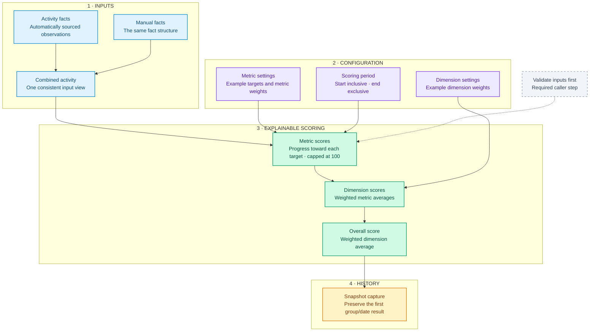

# Community Engagement Scoring

**An inspectable SQL pipeline: activity facts → metric scores → weighted dimensions → score history.**

SQL · Data modeling · Configurable scoring · Synthetic data · Automated checks

## About this project

During a data internship, I developed an engagement-scoring system using Microsoft Fabric Warehouse and T-SQL, with a manual-input workflow using Power Apps and Power Automate.

This repository is a **new public reconstruction of selected architectural patterns**, prepared with AI assistance. It is not the original implementation or a renamed copy of it. The source interfaces, metric definitions, scoring formula, targets, weights, dates, and example observations here were created for this demonstration. Original organizational rules, schemas, records, program names, and operational reports are not included.

The example makes the engineering approach inspectable without distributing the original scoring policy. It demonstrates separate input and calculation layers, a shared contract for automated and manual activity, configurable weighting, and dated score capture.

## Architecture



| Layer | Responsibility |
| --- | --- |
| Facts | Store a group, metric, date, and numeric observation |
| Configuration | Define the demonstration's targets and relative weights |
| Metrics | Measure capped progress toward each configured target |
| Dimensions | Calculate a weighted average of metric scores |
| Overall | Calculate a weighted average of dimension scores |
| History | Preserve the first captured score for each group and snapshot date |

The public sample contains **7 tables and 4 views**, plus validation and snapshot statements. These counts describe this reconstruction, not the original internship system.

## Example scoring

The following deliberately simple formula is specific to this public demonstration:

```text
Metric score = min(observed value / example target, 1) × 100
Dimension score = weighted average of its metric scores
Overall score = weighted average of dimension scores
```

All example facts are invented. The supplied fixture produces:

| Fictional group | Activity | Learning | Overall |
| --- | ---: | ---: | ---: |
| Example Group A | 80 | 100 | 88 |
| Example Group B | 50 | 0 | 30 |
| Example Group C | 0 | 0 | 0 |

These are demonstration outputs, not organizational measurements. A group without qualifying activity receives zero. Values above a target are capped at 100 for that metric. Configuration must pass validation before scoring.

### Trace one score: Example Group A

Every number below comes from the fictional fixture in this repository.

| Example metric | Observed / target | Metric score | Weight within its dimension |
| --- | ---: | ---: | ---: |
| Tasks | 8 / 8 | 100 | 2 |
| Sessions | 2 / 5 | 40 | 1 |
| Notes | 3 / 3 | 100 | 1 |

| Calculation stage | Calculation | Result |
| --- | --- | ---: |
| Activity dimension | `(100 × 2 + 40 × 1) / (2 + 1)` | 80 |
| Learning dimension | `100 × 1 / 1` | 100 |
| Overall score | `(80 × 6 + 100 × 4) / (6 + 4)` | **88** |

The intermediate views expose these stages separately, so a reader can explain the final score rather than only see the result.


## Run the checks

From the repository root, with Python 3 installed:

```bash
python3 -m unittest discover -s tests -v
```

No additional Python packages, credentials, or network access are required. The tests execute the included table/view SQL in an in-memory SQLite database with a `dbo` namespace. They verify the synthetic outputs, manual inputs, date boundaries, capping, weight normalization, invalid-input detection, and sequential snapshot reruns.

**Validation boundary:** the SQL uses a deliberately small common subset with T-SQL-style names and types. SQLite checks the example calculations; it does not establish Microsoft Fabric compilation, type behavior, permissions, concurrency, or deployment compatibility. No live warehouse deployment is claimed.

## Explore the implementation

| File | What it demonstrates |
| --- | --- |
| [Tables](sql/01_tables.sql) | Small, generic fact and configuration contracts |
| [Activity view](sql/02_activity_view.sql) | Combining automatic and manual inputs |
| [Metric scores](sql/03_metric_scores.sql) | Date filtering, aggregation, and configurable targets |
| [Dimension scores](sql/04_dimension_scores.sql) | Normalized weighting within a dimension |
| [Overall scores](sql/05_overall_scores.sql) | Combining dimension scores |
| [Input validation](sql/validate_inputs.sql) | Configuration consistency and input references |
| [Snapshot capture](sql/06_snapshot.sql) | Sequential rerun handling and historical preservation |
| [Synthetic fixture](examples/synthetic_data.sql) | Invented configuration and activity |
| [Tests](tests/test_scoring.py) | Executable examples and boundary checks |

## Design decisions and limits

- **Facts instead of entered scores.** Manual activity uses the same input shape as automated activity; SQL performs the calculations.
- **Configuration separated from computation.** Targets and weights live in configuration tables. Only invented example values are supplied.
- **Explicit date interval.** Activity is included from the start date up to, but excluding, the end date. Exactly one scoring-period row is required.
- **Visible intermediate results.** Metric and dimension views explain how an overall score was calculated.
- **Validation before use.** `validate_inputs.sql` must return zero rows. The views do not automatically execute this check. The sample tables do not enforce uniqueness or foreign keys.
- **History with a defined rerun policy.** A sequential repeat preserves an existing group/date snapshot. Concurrent writers require additional deployment coordination. History stores overall scores, not configuration versions; a production design would also need policy-version tracking.
- **Input ownership remains external.** The example has no authentication, application connector, scheduler, or event deduplication. Each input fact must be supplied once; repeated rows are treated as separate observations.

Power Apps and Power Automate are part of the original project's context, not included integrations in this example. This repository makes no claims about production-scale performance or live organizational outcomes.

## Author

**Rana Yum**

Original internship work: SQL scoring architecture, metric development, manual-entry workflow, and score-history components. This public reconstruction presents selected design patterns with fictional inputs and a new example policy.

[GitHub](https://github.com/ranayum) · [LinkedIn](https://www.linkedin.com/in/halise-rana-yum/)
